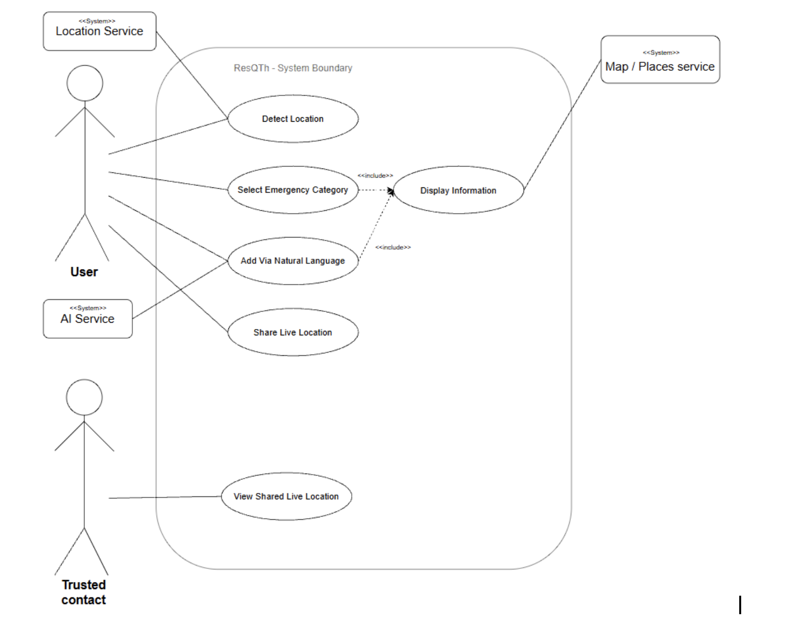

# Software Requirements Specification

# ResQTh

Introduction to Software Engineering (15031001) · Week 3 · Requirements & Specification

| Field | This example |
|---|---|
| Team name | ILY3000 |
| Project title | ResQTh - Intelligent emergency response and post-incident action guide for Thailand |
| SDLC chosen in M1 + reason | Incremental — ship the MVP first, add any additional features will be later |
| Date / version | v2.0 · Week 10, Updated FR-5 and Traceability |
| GitHub repo | https://github.com/hlainghtaymin808/ResQTh |

---

# 1. Introduction

## 1.1 Purpose and scope

The purpose of ResQTh is to develop an AI-assisted emergency information and post-incident guidance system in Thailand that helps users access verified emergency contacts and relevant guidance based on their location and situation. The system distinguishes between high-urgency crisis situations and low-urgency post-incident scenarios.

The project follows an incremental development approach. The MVP includes detecting the user’s location (FR-1), selecting an emergency category (FR-2), displaying emergency information and action tools appropriate to urgency (FR-3), natural-language emergency search (FR-4), and finding nearby emergency facilities (FR-6). The second increment covers sharing live location with a trusted contact (FR-5).

Police and medical responder dispatch, as well as live vehicle tracking, may be considered in future increments but are outside the current development scope. Offline on-device large language model (LLM) processing, voice-based search, and medical treatment instructions are also outside the current scope.

## 1.2 Users and stakeholders

| Name / role | Kind | What they need | What they fear / forbid |
|---|---|---|---|
| Foreign residents or visitors in Thailand | Primary user | Emergency contact, information and guideline in English | Confusion or navigating to the wrong place during a crisis, not knowing what to do |
| Emergency Operators / Dispatchers | Secondary stakeholder | Assurance that the AI-assisted system provides only verified contacts and information from the database. | Foreigners calling the wrong department because the system misinterpreted their request. |
| Trusted contacts | Secondary users | Need access to a live location-sharing link with clear status indicating whether sharing is active, stopped, or expired. | Fears of unauthorized access to the link or unclear sharing status. |
| Technical Team / Data Provider | Institution or supplier | Clear data boundaries and reliable emergency database management | System outage during critical queries or unauthorized data manipulation and data leakage |

---

# 2. Overall description

## 2.1 Product context — what it does / does not

ResQTh provides emergency-contact information and guidance for users in Thailand. Everything below is the current MVP scope and the future concepts are not implied to be operational.

| IN SCOPE (MVP this term) | OUT OF SCOPE (explicit promise) |
|---|---|
| FR-1 Detect user’s location | Group chat / messaging inside the app |
| FR-2 Select an emergency category | Any payment or subscription feature |
| FR-3 Display the information, including relevant facilities and links to directions | Display any ads-related information such as private hospitals or services |
| FR-4 Natural-language emergency search | Give medical treatment instructions. |
| FR-5 Share live location with a trusted contact, with user-controlled stopping and link expiration. | Direct automated despatching of police or medical units (the app provides one-tap phone calls and GPS sharing, but does not auto-dispatch responders) |
| FR-6 Find nearby emergency facilities | |

## 2.2 Assumptions and constraints

- **Assumption:** Users access the system through a mobile device or browser that supports the required location, search, and live-location-sharing functions.
- **Constraint:** One LLM API call per natural-language query; no custom model training or fine-tuning. (Implementation details for the current prototype remain to be confirmed.)
- **Constraint:** Thai and English UI text; no paid API beyond the single LLM call per request.
- **Constraint:** The system will use an external location/map and place service instead of developing its own mapping system, subject to provider usage limits and performance constraints.

---

# 3. Functional requirements

**Format:** As a `<role>`, I want `<goal>`, so that `<benefit>`. Every story below traces to a pain observed in a (simulated) student interview, and every acceptance criterion is something a test could actually check.

## FR-1 — Detect user’s location

**User story:** As a foreign resident in Thailand, I want the system to detect my current province automatically or let me set it manually, so that I receive localized emergency contacts and facility routing tailored to my exact area.

**Pain this traces to:** In an emergency, users often do not know their exact province or cannot spell local Thai location names accurately under stress.

**Acceptance criteria:**

1. Given that the user has enabled location permissions, when the system receives the GPS coordinates, it identifies the current province and filters all subsequent emergency results to match that area.
2. Given that the user denies location permission or GPS signal fails, when the system loads the interface, then it prompts the user to manually select their province from a fallback menu before loading emergency data.

## FR-2 — Select an emergency category

**User story:** As a user in distress, I want to filter emergency options by specific incident categories, so that the system immediately routes me to the right authority and appropriate urgency interface.

**Pain this traces to:** Panic during emergencies makes reading through unstructured lists difficult, while choosing the wrong department causes dangerous delays in getting help.

**Acceptance criteria:**

1. Given a list of predefined category options (e.g Medical Emergency, Police/Crime, Tourist Police, Lost Passport), when the user selects a category, then the system filters contacts matching that category and assigns its corresponding urgency tag (High-urgency or Low-Urgency).
2. Given an active category selection, when the user clears the category filter, then the system resets the view to display general emergency hotlines for the selected province.

## FR-3 — Display the information

**User story:** As a user in Thailand, I want the system to present contact details and action tools tailored to the urgency of my situation so that I can take immediate action during a crisis or follow a structured checklist post-incident.

**Pain this traces to:** Users struggle to navigate static lists during panic, whereas post-incident scenarios require procedural guidance rather than just phone numbers.

**Acceptance criteria:**

1. Given a selected or parsed emergency category tagged as high-urgency (e.g., active crime, medical emergency), when the system renders the emergency information, then it displays a high-urgency interface featuring one-tap hotline dialing, a high-contrast Thai-English assistance card, and an option to share the user’s current location as a single snapshot.
2. Given a selected or parsed emergency category tagged as low-urgency (e.g., lost passport, non-violent theft), when the system renders the emergency information, then it displays a low-urgency interface featuring an interactive step-by-step resolution checklist, incident note logging, and routing to official facilities.
3. Given a scenario where no local contact matches the exact category in that province, when the system executes the search, then it displays the national emergency hotline as a default fallback.

## FR-4 — Add via Natural-language (AI-assisted)

**User story:** As a foreigner, I want to type a query in Thai or English, such as "I lost my passport in Phuket" or "car accident near Chiang Mai", so that the system can identify the appropriate emergency category, location, and urgency level.

**Pain this traces to:** Foreigners do not know local emergency classification terms or which specific department handles their scenario.

**Acceptance criteria:**

1. Given a natural-language emergency prompt, when the user submits it, then the system extracts or suggests the category, province, and urgency level, then routes the user to the matching FR-3 display interface.
2. Given an incorrect AI system suggestion, when the user manually overrides the category or province before searching, the system updates results using the user's manual selection.
3. Given a prompt that is unclear or fits more than one category, when the user submits it, the system does not guess silently: it selects a high-urgency category if injury or danger is mentioned, lists other possible categories with their urgency, and, if none fits, shows a “not sure” card with one-tap calls to 1669 and 191.

## FR-5 — Share live location with a trusted contact

**User story:** As a user in Thailand, I want to send a live-location link to someone I trust, so that they can see where I am and come or call for help.

**Pain this traces to:** A trusted contact may not know where the user is or whether a previously shared location is still up to date.

**Acceptance criteria:**

1. Given internet connectivity and the user’s current location are available, when the user selects a trusted contact, chooses a sharing duration, and confirms sharing, the system provides a sharing link and clearly indicates that live sharing is active.
2. Given an active sharing link, when the trusted contact opens it, the system displays the user’s latest shared location, latest update time, and sharing status.
3. Given an active sharing session, when the user stops sharing or the selected duration expires, the link no longer provides access to the user’s location and displays that sharing has ended.

## FR-6 — Find nearby emergency facilities (added)

**User story:** As a user in Thailand, I want to find nearby emergency facilities by selecting a facility type, so that I can identify relevant places and access directions when I need assistance.

**Pain this traces to:** Users unfamiliar with their surroundings may not know where to find the nearest hospital, police station, or other relevant emergency facility.

**Acceptance criteria:**

1. Given that the user has enabled location access, when the user selects a facility type, the system displays matching nearby facilities with their names and estimated distances. In the current prototype, nearby entries are sample data and must be presented as such.
2. Given location access is unavailable or nearby results cannot be retrieved, when the user opens the nearby finder, the system displays an appropriate message and provides an available alternative, such as enabling location access or returning to the emergency directory.
3. Given a nearby facility is displayed, when the user selects its directions option, the system attempts to open the facility as the destination in an external map service. If the map service cannot be opened, the system displays an appropriate message.

---

# 4. Non-functional requirements

**Forbidden words unless quantified:** fast, easy, user-friendly, smart, secure. NFR-5 (security/privacy) is required for M2 — every SRS must have at least one.

| ID | Kind | Statement (testable) | How we will check |
|---|---|---|---|
| NFR-1 | Performance | Emergency action interfaces (high-urgency one-tap view or low-urgency checklist view) shall render in under 3 seconds after the user confirms a selection under the tested network condition. | Measure the time from confirmation to full display over three trials, recording device and network conditions. |
| NFR-2 | Performance | The natural-language search shall display an interpreted draft or a failure message within 4 seconds of query submission. | Measure response time across 10 test queries. |
| NFR-3 | Usability | A first-time user shall find the relevant emergency hotline in under 20 seconds without asking a teammate. | Conduct a timed trial with a user who has not seen the app interface. |
| NFR-4 | Reliability | After required data has been successfully loaded and cached, the offline database cache shall display pre-loaded national emergency hotlines and basic step-by-step action checklists for common low-urgency categories if network connectivity fails. | Load and cache the data, disconnect the network, reload the app, and verify that hotlines and checklists remain visible. |
| NFR-5 | Security / privacy (required) | The system shall not store GPS coordinates or link queries or coordinates to personally identifiable information during ordinary emergency searches. Coordinates are sent to the external location service only on explicit province-detection requests. Location is shared with a trusted contact only during a user-initiated sharing session, and the link shall become inactive when sharing stops or expires. | Inspect browser storage and logs where available, review the location-service request flow, test that location permission is requested only after user action, and verify that stopped or expired sharing links no longer expose location. Confirm against the actual implementation and external service practices. |

---

# 5. Use cases

## 5.1 Use-case list

| Use case | Actor | Related FR | Brief success story |
|---|---|---|---|
| UC-1 Detect location | User | FR-1 | User location identified as “Phuket”; system displays local emergency directory. |
| UC-2 Filter category | User | FR-2 | The user selects “Tourist Police”; the system filters out non-relevant hotlines. |
| UC-3 Display emergency information | User | FR-3 | The system detects urgency level and renders either high-urgency tools (one-tap hotline call, Thai translation card, GPS broadcast) or low-urgency tools (step-by-step checklist, facility routing). |
| UC-4 Add via Natural-language | User | FR-4 | User types "stolen bag in Bangkok"; system extracts category, location, and low urgency level, automatically redirecting to the FR-3 display interface. |
| UC-5 Share live location | User | FR-5 | User starts sharing and the trusted contact can view the location and status. Access ends when sharing stops or expires. |
| UC-6 Find nearby emergency facilities | User | FR-6 | User selects a facility type and views nearby facility entries with distances and a direction option. |

## 5.2 Use-case diagram

---

# 6. Out of scope

1. Group chat or messaging inside the app.
2. Any payment or subscription feature.
3. Display any ads-related information such as private hospitals or services.
4. Give medical treatment instructions.
5. Direct automated dispatching of police or medical units. The app may provide one-tap phone calls and user-initiated location sharing, but it does not automatically dispatch responders.

---

# 7. Traceability matrix (Golden Thread)

Only FR-3 is filled all the way across — that is the single thread this course follows week by week (Ch3 → Ch4/5 → Ch6 → Ch7). The other rows stay open until their week arrives, exactly like your own M2 should.

| Problem / pain | Requirement (FR) | Solution / design | Feature built | Test |
|---|---|---|---|---|
| Unfamiliarity with regional hotline numbers | FR-1 detect location | Automatic GPS detection; manual province fallback. | Province-selection screen, browser geolocation and province lookup attempt. | Test GPS success, denied permission, GPS failure, and manual selection: verify results use selected province. |
| Confusion selecting the right department | FR-2 select category | Category filtering, urgency labels, and clear-filter behavior. | Home screen with nine category options and category-based hotline filtering. | Test each category, matching contacts/urgency labels, and reset to general hotlines. |
| Panic during high-risk events / lack of post-incidence guidance | FR-3 Display the information | Separate high-urgency action screen and low-urgency checklist: facility and directions cards. | High-urgency assistance interface, low-urgency case pack, facility cards, directions controls. | Test both urgency levels, national-hotline fallback, checklist, and map-failure message. |
| Foreigner unaware of local terms | FR-4 Natural-language search | Query interpretation and editable category/province/urgency draft. | English/Thai keyword-based parser and result-review screen; implementation is not LLM-based parser in the current prototype. | Test supported English/Thai prompts, ambiguous requests, incorrect suggestions, and manual overrides. |
| Trusted contacts cannot track location during an emergency | FR-5 Share live location | Recipient and duration selection, sharing link, status, stop, and expiration controls. | Prototype sharing interface and simulated trusted-contact phone. | Test start, recipient view, stop, and expiration in the simulation: mark real live sharing as not implemented unless verified. |
| Users do not know where nearby emergency facilities are | FR-6 Find nearby facilities | Dedicated nearby screen with facility-type filters, location handling, results, and directions. | Nearby screen with sample place names, calculated distances, and map-style visualization. | Test facility filters, location unavailable, result labels, distance calculation, and directions behavior: verify sample data is clearly identified. |

---

# 8. AI usage log

If this table is empty but the prose looks generated, the milestone is capped at 50% — log every prompt that drafted a story or paragraph, honestly.

| Date | Tool / model | What we asked | What AI produced | What we changed / verified | What we learned |
|---|---|---|---|---|---|
| 18 Aug 2026 | Gemini | Emergency information website for both locals and foreigners that has any name that is easy to remember and shorter. | Safebridge; ResQ. | Added “Th” at the end of “ResQ” as we wanted to represent our services in Thailand. | |
| 23 Aug 2026 | Gemini | Draft our scattered thoughts and ideas into structured sections that align with the provided project layout. (we provided our ideas) | Updated SRS document sections matching exact course structure. | Edited stakeholder, Technical team need and what they fear; Updated FR, NFR section to align with our project scope; Updated constraints of our concern; Edited use case of our preference. | How to layout our requirements and preferences in our project; how to use AI to draft our ideas and modify it according to our project requirements and do the review. |
| 4 Sep 2026 | ChatGPT | Check any typo errors in our documents. | Parts where I am having typo errors. | We scanned the documents again and checked pointed areas if the errors were really there and fixed what was needed. | How to use AI as a tool on time-consuming and tedious tasks, and verify the results as humans. |
| 18 Oct 2026 | Perplexity | Asked whether the updated prototype matched the original SRS. | It suggested use-case and traceability updates. | The team updated the diagram and reviewed affected sections. | Getting things done through precise prompts and reviewing the output, taking responsibility for the final result. |

---

# 9. Self-check

- [x] Every FR is a user story with a benefit — all FRs in §3 end in a “so that” clause tied to a real pain.
- [x] Every FR has acceptance criteria you could actually test — 2 AC per FR, each a number, a state, or a yes/no.
- [x] No FR is vague — no bare “fast”, “easy”, or “user-friendly” anywhere in §3.
- [x] NFRs exist, including security / privacy — NFR-5 covers the required privacy check.
- [x] Every FR traces back to a stated problem — see “Pain this traces to” under each FR, and §7.
- [x] Scope and out-of-scope are stated — §2.1 and §6.
- [x] Use-case list matches the FR list — 4 use cases, one per FR (diagram added Week 4).
- [x] AI log is honest — §8 shows exactly what was asked, drafted, and hand-corrected.

**Course rule:** you may use AI to draft. You must log it, verify it against a real stakeholder, and be able to explain every FR in the oral exam. Work you cannot explain earns no credit.
