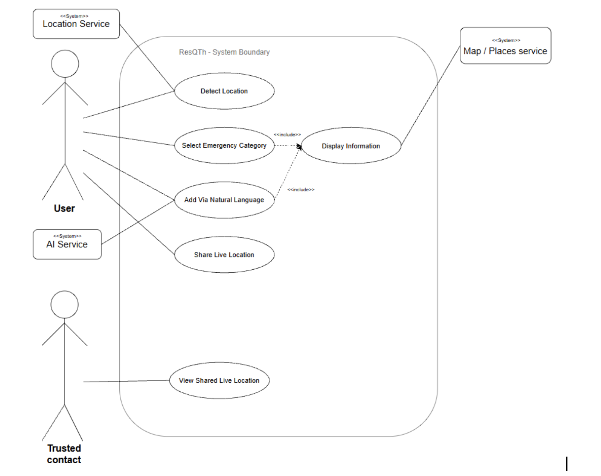

# ResQTh — Software Requirements Specification (M2)

**Project:** ResQTh

> Introduction to Software Engineering (15031001) · Week 3 · Requirements & Specification

```text
Field                      This example
Team name                  ILY3000
Project title              ResQTh - Intelligent emergency response and post-incident action guide for Thailand
SDLC chosen in M1 +        Incremental — ship the MVP first, add any additional features will be later
reason
Date / version             v2.0 · Week 10, Updated FR-5 and Traceability
GitHub repo                https://github.com/addrick-star/IntroSE.git
```
## 1. Introduction

### 1.1 Purpose and Scope

The purpose of ResQTh is to develop an AI-assisted emergency information and post-incident guidance system in Thailand that helps users access verified emergency contacts and relevant guidance based on their location and situation. The system distinguishes between high-urgency crisis situations and low-urgency post-incident scenarios. The project follows an incremental development approach. The MVP includes detecting the user’s location (FR-1), selecting an emergency category (FR-2), displaying emergency information and action tools appropriate to urgency (FR-3), natural-language emergency search (FR-4), and finding nearby emergency facilities (FR-6). The second increment covers sharing live location with a trusted contact (FR-5). Police and medical responder dispatch, as well as live vehicle tracking, may be considered in future increments but are outside the current development scope. Offline on-device large language model (LLM) processing, voice-based search, and medical treatment instructions are also outside the current scope.
### 1.2 Users and Stakeholders

```text
Name / role             Kind               What they need                         What they fear / forbid
Foreign residents or    primary user       Emergency contact, information         Confusion or navigating to the
visitors in Thailand                       and guideline in English               wrong place during a crisis, not
knowing what to do
Emergency Operators/    secondary          Assurance that the AI-assisted         Foreigners calling the wrong
Dispatchers             stakeholder        system provides only verified          department because the system
contacts and information from the      misinterpreted their request.
database.
Trusted contacts        secondary users    Need       access    to     a   live   Fears of unauthorized access to the
location-sharing link with clear       link or unclear sharing status.
status indicating whether sharing is
active, stopped, or expired
Name / role               Kind                  What they need                         What they fear / forbid
Technical Team/ Data      institution     or    Clear data boundaries and reliable     System outage during critical
Provider                  supplier              emergency database management          queries or unauthorized data
manipulation and data leakage
```
## 2. Overall Description

### 2.1 Product Context — What It Does / Does Not

ResQTh provides emergency-contact information and guidance for users in Thailand. Everything below is the current MVP scope and the future concepts are not implied to be operational.
```text
IN SCOPE (MVP this term)                                  OUT OF SCOPE (explicit promise)
- FR-1 Detect user’s location                             - Group chat / messaging inside the app
- FR-2 Select an emergency category                       - Any payment or subscription feature
- FR-3 Display the information, including relevant        - Display any ads-related information such as private hospitals or
facilities and links to directions                        services
- FR-4 Natural-language emergency search                  - Give medical treatment instructions.
- FR-5 Share live location with a trusted contact, with   - Direct automated despatching of police or medical units (the
user-controlled stopping and link expiration.             app provides one-tap phone calls and GPS sharing, but does not
- FR-6 Find nearby emergency facilities                   auto-dispatch responders)
2.2 Assumptions and constraints
- Assumption: Users access the system through a mobile device or browser that supports the required
location, search, and live-location-sharing functions.
- Constraint: One LLM API call per natural-language query; no custom model training or fine-tuning.
(Implementation details for the current prototype remain to be confirmed.)
- Constraint: Thai and English UI text; no paid API beyond the single LLM call per request.
- Constraint: The system will use an external location/map and place service instead of developing its own
mapping system, subject to provider usage limits and performance constraints.
```
## 3. Functional Requirements

Format: As a <role>, I want <goal>, so that <benefit>. Every story below traces to a pain observed in a (simulated) student interview, and every acceptance criterion is something a test could actually check.
### FR-1 — Detect User’s Location

**User story:** As a foreign resident in Thailand, I want the system to detect my current province automatically or

let me set it manually, so that I receive localized emergency contacts and facility routing tailored to my exact area.
**Pain this traces to:** In an emergency, users often do not know their exact province or cannot spell local Thai

location names accurately under stress.
1. Given that the user has enabled location permissions, when the system receives the GPS coordinates, it
identifies the current province and filters all subsequent emergency results to match that area.
2. Given that the user denies location permission or GPS signal fails, when the system loads the interface,
then it prompts the user to manually select their province from a fallback menu before loading emergency data.
### FR-2 — Select an Emergency Category

**User story:** As a user in distress, I want to filter emergency options by specific incident categories, so that the

system immediately routes me to the right authority and appropriate urgency interface.
**Pain this traces to:** Panic during emergencies makes reading through unstructured lists difficult, while choosing

the wrong department causes dangerous delays in getting help.
1. Given a list of predefined category options (e.g Medical Emergency, Police/Crime, Tourist Police, Lost
Passport), when the user selects a category, then the system filters contacts matching that category and assigns its corresponding urgency tag (High-urgency or Low-Urgency) .
2. Given an active category selection, when the user clears the category filter, then the system resets the view
to display general emergency hotlines for the selected province.
### FR-3 — Display the Information

**User story:** As a user in Thailand, I want the system to present contact details and action tools tailored to the

urgency of my situation so that I can take immediate action during a crisis or follow a structured checklist post-incident.
**Pain this traces to:** Users struggle to navigate static lists during panic, whereas post-incident scenarios require

procedural guidance rather than just phone numbers.
1. Given a selected or parsed emergency category tagged as high-urgency (e.g., active crime, medical
emergency), when the system renders the emergency information, then it displays a high-urgency interface featuring one-tap hotline dialing, a high-contrast Thai-English assistance card, and an option to share the user’s current location as a single snapshot.
2. Given a selected or parsed emergency category tagged as low-urgency (e.g., lost passport, non-violent
theft), when the system renders the emergency information, then it displays a low-urgency interface featuring an interactive step-by-step resolution checklist, incident note logging, and routing to official facilities.
3. Given a scenario where no local contact matches the exact category in that province, when the system
executes the search, then it displays the national emergency hotline as a default fallback.
### FR-4 — Add via Natural Language (AI-Assisted)

**User story:** As a foreigner, I want to type a query in Thai or English, such as "I lost my passport in Phuket" or

"car accident near Chiang Mai", so that the system can identify the appropriate emergency category, location, and urgency level.
**Pain this traces to:** Foreigners do not know local emergency classification terms or which specific department

handles their scenario.
1. Given a natural-language emergency prompt, when the user submits it, then the system extracts or
suggests the category, province, and urgency level, then routes the user to the matching FR-3 display interface.
2. Given an incorrect AI system suggestion, when the user manually overrides the category or province
before searching, the system updates results using the user's manual selection.
3. Given a prompt that is unclear or fits more than one category, when the user submits it, the system does
not guess silently: it selects a high-urgency category if injury or danger is mentioned, lists other possible categories with their urgency, and, if none fits, shows a “not sure” card with one-tap calls to 1669 and 191.
### FR-5 — Share Live Location with a Trusted Contact

**User story:** As a user in Thailand, I want to send a live-location link to someone I trust, so that they can see

where I am and come or call for help.
**Pain this traces to:** A trusted contact may not know where the user is or whether a previously shared location is

still up to date.
1. 1. Given internet connectivity and the user’s current location are available, when the user selects a
trusted contact, chooses a sharing duration, and confirms sharing, the system provides a sharing link and clearly indicates that live sharing is active.
2. 2. Given an active sharing link, when the trusted contact opens it, the system displays the user’s latest
shared location, latest update time, and sharing status.
3. 3. Given an active sharing session, when the user stops sharing or the selected duration expires, the link
no longer provides access to the user’s location and displays that sharing has ended.
### FR-6 — Find Nearby Emergency Facilities

**User story:** As a user in Thailand, I want to find nearby emergency facilities by selecting a facility type, so that I

can identify relevant places and access directions when I need assistance.
**Pain this traces to:** Users unfamiliar with their surroundings may not know where to find the nearest hospital,

police station, or other relevant emergency facility.
1. 1. Given that the user has enabled location access, when the user selects a facility type, the system
displays matching nearby facilities with their names and estimated distances. In the current prototype, nearby entries are sample data and must be presented as such.
2. 2. Given location access is unavailable or nearby results cannot be retrieved, when the user opens the
nearby finder, the system displays an appropriate message and provides an available alternative, such as enabling location access or returning to the emergency directory.
3. 3. Given a nearby facility is displayed, when the user selects its directions option, the system attempts
to open the facility as the destination in an external map service. If the map service cannot be opened, the system displays an appropriate message.
## 4. Non-Functional Requirements

Forbidden words unless quantified: fast, easy, user-friendly, smart, secure. NFR-5 (security/privacy) is required for M2 — every SRS must have at least one.
```text
ID           Kind                 Statement (testable)                                    How we will check
```
**NFR-1        performance          Emergency action interfaces(high-urgency one-tap        Measure      the    time from**
view or low-urgency checklist view) shall render in     confirmation to full display over under 3 seconds after the user confirms a selection     three trials, recording device under the tested network condition,                     and network conditions.
**NFR-2        performance          The natural-language search shall display an            Measure response time across**
interpreted draft or a failure message within 4         10 test queries. seconds of query submission.
**NFR-3        usability            A first-time user shall find the relevant emergency     Conduct a timed trial with a**
hotline in under 20 seconds without asking a            user who has not seen the app teammate.                                               interface..
**NFR-4        reliability          After required data has been successfully loaded        Load and cache the data,**
and cached, the offline database cache shall display    disconnect the network, reload pre-loaded national emergency hotlines and basic        the app, and verify that hotlines step-by-step action checklists for common               and checklists remain visible. low-urgency categories if network connectivity fails.
**NFR-5        security / privacy   The system shall not store GPS coordinates or link      Inspect browser storage and**
(required)           queries or coordinates to personally identifiable       logs where available, review the information during ordinary emergency searches.         location-service request flow, test that location permission is Coordinates are sent to the external location service requested only after user action, only on explicit province-detection requests.           and verify that stopped or Location is shared with a trusted contact only          expired sharing links no longer during a user-initiated sharing session, and the link   expose      location.   Confirm shall become inactive when sharing stops or             against         the        actual expires.                                                implementation and external service practices.
## 5. Use Cases

### 5.1 Use-Case List

```text
Use case                         Actor   Related FR   Brief success story
UC-1 Detect location             User    FR-1         User location identified as “Phuket”; system
displays local emergency directory
UC-2 Filter category             User    FR-2         The user selects “Tourist Police”; the system
filters out non-relevant hotlines.
UC-3 Display       emergency     User    FR-3         The system detects urgency level and renders
information                                           either high-urgency tools (one-tap hotline
call, Thai translation card, GPS broadcast) or
low-urgency tools (step-by-step checklist,
facility routing).
UC-4         Add           via   User    FR-4         User types "stolen bag in Bangkok"; system
Natural-language                                      extracts category, location, and low urgency
level, automatically redirecting to the FR-3
display interface.
UC-5 Share live location         User    FR-5         User starts sharing and the trusted contact can
view the location and status. Access ends
when sharing stops or expires.
UC-6 Find nearby emergency       User    FR-6         User selects a facility type and views nearby
facilities                                            facility entries with distances and a direction
option.
5.2 Use-case diagram


## 6. Out of Scope

1. Group chat or messaging inside the app.
2. Any payment or subscription feature.
3. Display any ads-related information such as private hospitals or services.
4. Give medical treatment instructions.
5. Direct automated dispatching of police or medical units. The app may provide one-tap phone calls and
user-initiated location sharing, but it does not automatically dispatch responders.
## 7. Traceability Matrix (Golden Thread)

Only FR-3 is filled all the way across — that is the single thread this course follows week by week (Ch3 → Ch4/5 → Ch6 → Ch7). The other rows stay open until their week arrives, exactly like your own M2 should.
```text
Problem / pain          Requirement         Solution / design       Feature built            Test
(FR)
Unfamiliarity   with    FR-1       detect   Automatic        GPS    Province-selection       Test GPS success, denied
regional      hotline   location            detection:     manual   screen,       browser    permission, GPS failure,
numbers                                     province fallback.      geolocation        and   and manual selection:
province       lookup    verify results use selected
attempt.                 province.
Problem / pain               Requirement          Solution / design          Feature built            Test
(FR)
Confusion selecting          FR-2        select   Category          grid,    Home screen with         Test    each    category,
the right department         category             filtering,     urgency     nine category options    matching
labels, and clear-filter   and     category-based   contacts/urgency labels,
behavior.                  hotline filtering.       and reset to general
hotlines.
Panic during high-risk       FR-3 Display the     Separate                   High-urgency             Test both urgency levels,
events/    lack     of       information          high-urgency action        assistance interface,    national-hotline fallback,
post-incidence                                    screen              and    low-urgency       case   checklist,             and
guidance                                          low-urgency                pack, facility cards,    map-failure message.
checklist: facility and    directions controls.
directions cards.
Foreigner unaware of         FR-4                 Query interpretation       English/          Thai   Test supported English/
local terms                  Natural-language     and edible category/       keyword-based parser     Thai prompts, ambiguous
search               province/   urgency        and      result-review   requests,       incorrect
draft.                     screen:                  suggestions, and manual
implementation is not    overrides.
LLM-based parser in
the current prototype.
Trusted      contacts        FR-5 Share live      Recipient        and       Prototype      sharing   Test start, recipient view,
cannot track location        location             duration   selection,      interface          and   stop, and expiration in
during an emergency                               sharing link, status,      simulated                the simulation: mark real
stop, and expiration       trusted-contact phone    live sharing as not
controls.                                           implemented          unless
verified.
Users do not know            FR-6          Find   Dedicated      nearby      Nearby screen with       Test     facility    filters,
where       nearby           nearby facilities    screen           with      sample place names,      location       unavailable,
emergency facilities                              facility-type filters,     calculated distances,    result labels, distance
are                                               location     handling,     and          map-style   calculation,             and
results,          and      visualization.           directions        behavior:
directions.                                         verify sample data is
clearly identified.
```
## 8. AI Usage Log

If this table is empty but the prose looks generated, the milestone is capped at 50% — log every prompt that drafted a story or paragraph, honestly.
```text
Date        Tool         /     What we asked           What AI produced         What we changed /        What we learned
model                                                               verified
```
18 Aug      Gemini             Emergency               . safebridge             Added “Th” at the 2026                           information website     . ResQ                   end of “ResQ” as we for both locals and                              wanted to represent foreigners that has                              our    services   in any name that is                                 Thailand easy to remember and shorter
```text
Date        Tool         /   What we asked          What AI produced        What we changed /        What we learned
model                                                           verified
```
23 Aug      Gemini           Draft our scattered    Updated          SRS    -Edit     stakeholder,   -how to layout our 2026                         thoughts and ideas     document sections       Technical team need      requirements      and into      structured   matching        exact   and what they fear       preferences in our sections that align    course structure.       -Updated FR, NFR         project with the provided                              section to align with    -how to use Ai to project layout. (we                            our project scope        draft our ideas and provided our ideas)                            -Update            the   modify it according to constraints of our       our            project concern                  requirements and do -Edit use case of our    the review preference 4 Sep       ChatGPT          Check any      typo    Parts where I am        -We scanned the          how to use AI as a errors   in     our    having typo errors      document again and       tool               on documents                                      check pointed areas if   time-consuming and the errors were really   tedious tasks, and we there and fixed what     verify the results as was needed               humans 18 Oct      Perplexity       Asked whether the      It          suggested   The team updated the     Getting things done updated prototype      use-case         and    diagram and reviewed     through          precise matched the original   traceability updates.   affected sections.       prompt and reviewing SRS.                                                                    the output, taking responsibility for the final result taken
## 9. Self-Check

☑ Every FR is a user story with a benefit — all FRs in §3 end in a “so that” clause tied to a real pain. ☑ Every FR has acceptance criteria you could actually test — 2 AC per FR, each a number, a state, or a yes/no. ☑ No FR is vague — no bare “fast”, “easy”, or “user-friendly” anywhere in §3. ☑ NFRs exist, including security / privacy — NFR-5 covers the required privacy check. ☑ Every FR traces back to a stated problem — see “Pain this traces to” under each FR, and §7. ☑ Scope and out-of-scope are stated — §2.1 and §6. ☑ Use-case list matches the FR list — 4 use cases, one per FR (diagram added Week 4). ☑ AI log is honest — §8 shows exactly what was asked, drafted, and hand-corrected. Course rule: you may use AI to draft. You must log it, verify it against a real stakeholder, and be able to explain every FR in the oral exam. Work you cannot explain earns no credit.
